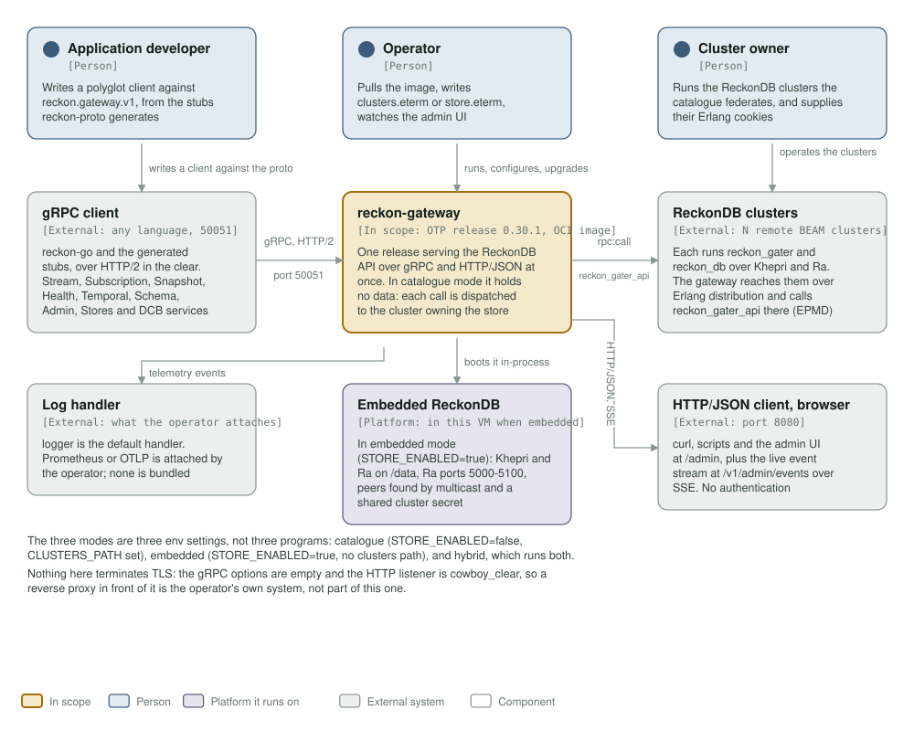
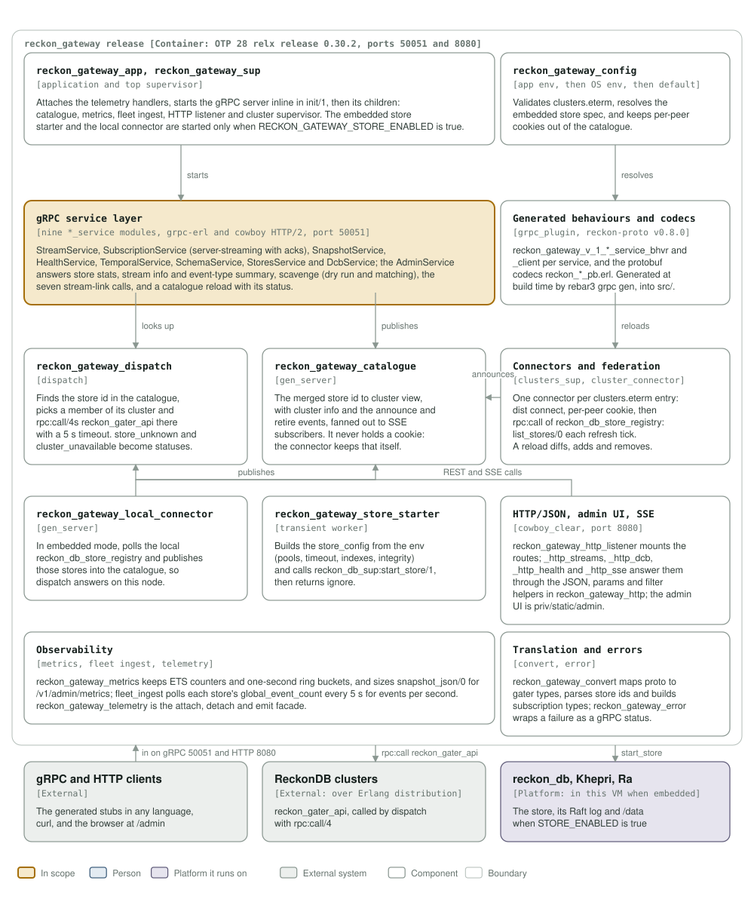

# reckon-gateway architecture

A C4 model of the gateway, drawn from the code in this repository rather than
from a template. `c4_diagrams.py` generates both diagrams; run it after a change
that adds, removes or renames a component:

```
python3 architecture/c4_diagrams.py
rsvg-convert -w 1400 assets/c4-context.svg -o /tmp/c4-context.png   # look at it
```

A diagram that still names a component the release lost is drift, and the
`c4 model` workflow fails a commit that drops either file or its link here.

## Level 1: system context



| Element | What it is | Why it is there |
|---|---|---|
| **reckon-gateway** | One Erlang/OTP release (0.30.1) in one OCI image: gRPC on 50051, HTTP/JSON on 8080, the admin UI and SSE | The system this repository builds |
| Application developer | Person | Writes a polyglot client from the stubs `reckon-proto` generates |
| Operator | Person | Pulls the image, writes `clusters.eterm` or `store.eterm`, watches the admin UI |
| Cluster owner | Person | Runs the ReckonDB clusters a catalogue federates, and supplies their Erlang cookies |
| gRPC client | External system | `reckon-go` and any language's generated stubs, over cleartext HTTP/2 |
| ReckonDB clusters | External system | Each runs `reckon_gater` and `reckon_db` over Khepri and Ra; reached over Erlang distribution |
| Embedded ReckonDB | Platform, in this VM | Started when `RECKON_GATEWAY_STORE_ENABLED` is true: Khepri and Ra on `/data` |
| HTTP/JSON client, browser | External system | curl, scripts and the admin UI at `/admin`, and the SSE stream at `/v1/admin/events` |
| Log handler | External system | `logger` by default; Prometheus or OTLP is attached by the operator, none is bundled |

Two things the diagram says by being absent: nothing here terminates TLS (the
gRPC options list is empty and the HTTP listener is `cowboy_clear`), so a reverse
proxy in front of it belongs to the operator; and the gateway holds no data in
catalogue mode, so every read and write is dispatched to the cluster that owns
the store id.

The three modes are three environment settings, not three programs:

| Mode | `STORE_ENABLED` | `CLUSTERS_PATH` |
|---|---|---|
| Catalogue | false | set: federate N remote clusters, hold nothing |
| Embedded | true | unset: one container, one local store |
| Hybrid | true | set: a local store **and** the remote clusters |

## Level 3: components



| Component | Real modules | Responsibility |
|---|---|---|
| Application and supervisor | `reckon_gateway_app`, `reckon_gateway_sup` | Attaches the telemetry handlers, starts the gRPC server inline in `init/1`, then the children |
| Configuration | `reckon_gateway_config` | App env, then OS env, then default; validates `clusters.eterm`, resolves the embedded store spec, keeps cookies out of the catalogue |
| gRPC service layer | `reckon_gateway_{stream,subscription,snapshot,health,temporal,schema,admin,stores,dcb}_service` | The nine `reckon.gateway.v1` services; subscription is server-streaming with acks |
| Generated behaviours and codecs | `reckon_gateway_v_1_*_service_bhvr`, `_client`, `reckon_*_pb` | Produced by `rebar3 grpc gen` from `reckon-proto` v0.8.0, into `src/` |
| Dispatch | `reckon_gateway_dispatch` | Finds the store id in the catalogue, picks a member, `rpc:call/4`s `reckon_gater_api` there with a 5 s timeout |
| Catalogue | `reckon_gateway_catalogue` | The merged store id to cluster view, the announce and retire events, and the SSE fan-out; never holds a cookie |
| Connectors and federation | `reckon_gateway_clusters_sup`, `reckon_gateway_cluster_connector` | One connector per `clusters.eterm` entry: dist connect, per-peer cookie, `rpc:call` of `reckon_db_store_registry:list_stores/0` each refresh tick |
| Local connector | `reckon_gateway_local_connector` | In embedded mode, publishes the local registry's stores into the catalogue |
| Store starter | `reckon_gateway_store_starter` | Builds the `store_config` from the env and calls `reckon_db_sup:start_store/1` |
| HTTP, admin UI, SSE | `reckon_gateway_http_listener`, `reckon_gateway_http_*` | The cowboy routes on 8080 and the static admin UI in `priv/static/admin` |
| Observability | `reckon_gateway_metrics`, `reckon_gateway_fleet_ingest`, `reckon_gateway_telemetry` | ETS counters and one-second ring buckets for `/v1/admin/metrics`; the fleet events-per-second figure |
| Translation and errors | `reckon_gateway_convert`, `reckon_gateway_error` | Proto to gater types, store id parsing, and a failure wrapped as a gRPC status |

## What this model does not say

- **How the cluster side works.** `reckon_gater` and `reckon_db` are other
  repositories; the gateway only names the calls it makes into them.
- **Which deployment shape is live.** The image is the same in all three modes;
  the fleet's compose files decide which one a box runs.
- **Auth.** There is none on either port: the admin UI and the API are as open as
  the network they are on.
